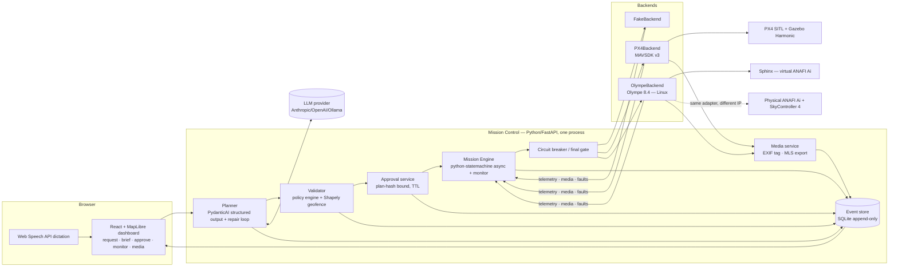
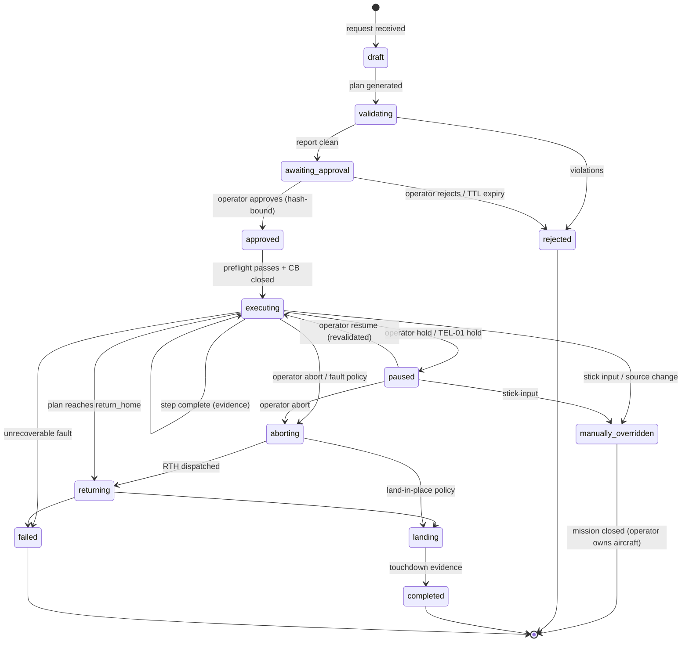
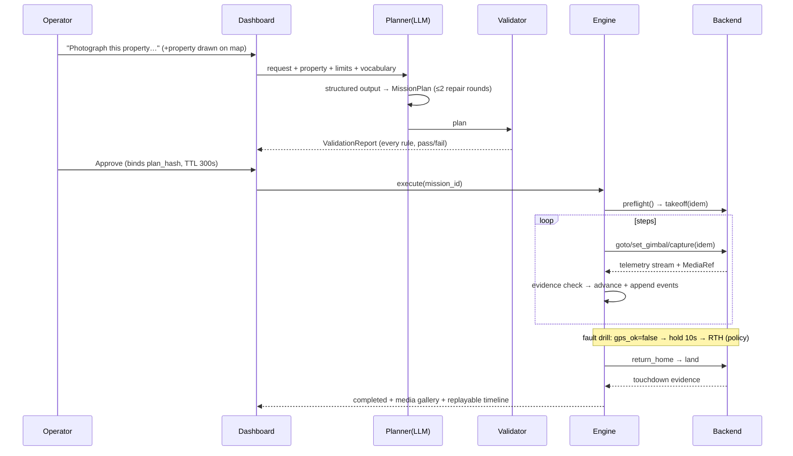

# 08 — Target System Architecture

**Status:** v1.0 — Phase 6 complete, 2026-08-14. Designs inside the settled constraints from docs 01/04/05/06. Simple model first, then detail, per working agreement.

---

## 1. The simple model

Three trust zones, one direction of increasing authority:

1. **The suggestion zone (untrusted):** voice/text and the LLM. Output = a *proposal* — a typed `MissionPlan`. Nothing here can move the aircraft.
2. **The judgment zone (deterministic + human):** the validator applies written rules; the operator reads a plain-language brief and approves or rejects. Only an approved, unmodified, unexpired plan passes.
3. **The execution zone (governed):** a state machine dispatches one validated step at a time through a `DroneBackend`, requires telemetry evidence before advancing, and owns every failure response. A final circuit breaker sits immediately before dispatch.

Everything that happens is appended to an immutable event log; the UI is a read model over that log plus live telemetry.

## 2. System context and components



**Deployment:** dev Macs run core + FakeBackend + UI; the Ubuntu box (Gate G2) runs SITL/gz in Docker, Sphinx natively, and OlympeBackend (Olympe is Linux x86_64-only). CI runs unit tests everywhere + headless SITL scenarios on Linux runners. The LLM is reached through PydanticAI with provider config (cloud key or local Ollama) — no telemetry streams to the provider; the planner receives only a bounded context block (property geometry, limits, vocabulary, battery snapshot).

**Repo layout (monorepo):**

```text
drone-mission/            # new integration repo (Gate G1: greenfield-lean, MDS as reference)
  core/                   # PURE domain — zero SDK imports (NFR3)
    schema.py  geo.py  shots.py  policy/  engine/  events.py
  backends/
    base.py  fake/  px4_mavsdk/  parrot_olympe/
  planner/                # prompts, PydanticAI agent, repair loop
  server/                 # FastAPI REST + WebSocket, media endpoints
  ui/                     # React + Vite + TS + MapLibre
  tests/                  # unit/ contract/ sitl_scenarios/
  worlds/                 # gz world (Fuel House 1 CC0) + Sphinx notes
```

## 3. MissionPlan schema v1 (field level)

Pydantic v2; every quantity unit-suffixed; `model_config = ConfigDict(extra="forbid")` everywhere (unknown fields = parse failure). All angles deg, distances m, speeds m/s.

```python
class GeoPoint(BaseModel):        # WGS84
    lat: float = Field(ge=-90, le=90)
    lon: float = Field(ge=-180, le=180)

class Property(BaseModel):
    center: GeoPoint                    # operator-confirmed on satellite map
    boundary: list[GeoPoint]            # ≥3 vertices, closed polygon (inclusion geofence)
    home: GeoPoint                      # launch/RTH point, must lie inside boundary

class Limits(BaseModel):
    max_alt_m: float = Field(default=40, gt=0, le=120)       # sim default; 120 m = Part 107 alignment
    max_speed_ms: float = Field(default=5, gt=0, le=8)       # ≤8 keeps ANAFI OA envelope valid
    max_home_dist_m: float = Field(default=150, gt=0, le=500)
    max_steps: int = Field(default=40, ge=1, le=60)

class FailsafePolicy(BaseModel):
    on_gps_loss: Literal["hold_then_rth"] = "hold_then_rth"  # enum grows only with evidence
    gps_hold_timeout_s: float = 10
    on_link_loss: Literal["backend_native_rth"] = "backend_native_rth"
    on_low_battery: Literal["rth"] = "rth"
    battery_floor_pct: float = Field(default=30, ge=15, le=60)   # preflight minimum
    battery_reserve_pct: float = Field(default=20, ge=10, le=50) # in-flight RTH trigger
    telemetry_stale_hold_s: float = 2.0
    telemetry_stale_failsafe_s: float = 10.0

class CaptureSpec(BaseModel):
    mode: Literal["single", "bracket3", "bracket5"] = "bracket3"   # maps 1:1 to ANAFI camera2 / PX4 evidence-grab
    tag: str = Field(pattern=r"^[a-z0-9_]{1,40}$")                 # e.g. "front_34_elevated"

# --- Steps: discriminated union on `action`; the ONLY vocabulary the LLM may emit ---
class Takeoff(BaseModel):    action: Literal["takeoff"];    alt_m: float = Field(gt=0, le=120)
class Goto(BaseModel):       action: Literal["goto"];       to: GeoPoint; alt_m: float; speed_ms: float = Field(gt=0, le=8)
class Orbit(BaseModel):
    action: Literal["orbit"]
    center: GeoPoint; radius_m: float = Field(ge=8, le=100); alt_m: float
    speed_ms: float = Field(gt=0, le=5); arc_deg: float = Field(default=360, gt=0, le=360)
    direction: Literal["cw", "ccw"] = "cw"
    captures_every_deg: float | None = Field(default=45, ge=10, le=180)
    capture: CaptureSpec | None = None
    yaw_mode: Literal["face_center"] = "face_center"
class SetGimbal(BaseModel):  action: Literal["set_gimbal"]; pitch_deg: float = Field(ge=-90, le=10)
class CapturePhoto(BaseModel): action: Literal["capture_photo"]; capture: CaptureSpec
class Hold(BaseModel):       action: Literal["hold"];       duration_s: float = Field(gt=0, le=60)
class ReturnHome(BaseModel): action: Literal["return_home"]
class Land(BaseModel):       action: Literal["land"]

MissionStep = Annotated[Takeoff | Goto | Orbit | SetGimbal | CapturePhoto | Hold | ReturnHome | Land,
                        Field(discriminator="action")]

class MissionPlan(BaseModel):
    plan_version: Literal[1]
    mission_id: str                      # ULID, server-assigned
    request_text: str                    # exact final operator text (STT already resolved)
    summary: str                         # LLM's plain-language brief, shown at approval
    property: Property
    limits: Limits
    failsafe: FailsafePolicy
    steps: list[MissionStep] = Field(min_length=1)
    # plan_hash computed server-side over canonical JSON; approvals bind to it
```

**Shot library (`core/shots.py`):** named shots compile to steps *before* validation — `front_34_elevated(center, heading, alt=20, dist=25)` → `goto + set_gimbal + capture_photo`; `lot_overhead` → `goto(center, alt≈alt_ceiling) + set_gimbal(-90) + capture`; `exterior_orbit` → `orbit(captures_every_deg=45)`. The LLM may emit either primitives or shot names (planner expands shots, so the validator always sees primitives). This mirrors QGC's SimpleItem/ComplexItem split (doc 04 §5).

**Geometry note (`core/geo.py`):** all distance/containment math happens in a local azimuthal-equidistant meters frame centered on `property.home` (pymap3d), because Shapely is planar. Frame/unit conversion is confined to this one module and property boundary/orbit annulus checks are pure functions with unit tests.

## 4. Validation — the policy rule catalog

Two invocations of the same engine: **static** (plan-time, produces `ValidationReport` shown at approval) and **dispatch gate** (per-step at execution, cheap re-checks against live state). Rules are pure functions `rule(plan | step, ctx) -> PolicyViolation | None`; every violation carries `rule_id`, human message, offending value, limit. Deny-by-default: missing context (e.g., no telemetry yet) fails the affected rule.

| Rule id | Check (constants from Limits/FailsafePolicy unless noted) |
|---|---|
| SCHEMA-01 | Pydantic parse: types, ranges, discriminators, extra="forbid" (runs before engine) |
| GEO-01 | Boundary polygon is valid, ≥3 pts, non-self-intersecting, area ≥ 100 m², ≤ 0.25 km² |
| GEO-02 | Home inside boundary (with 2 m margin) |
| GEO-03 | Every goto/orbit-annulus point inside boundary buffered −3 m (orbit checked as annulus of radius ± acceptance) |
| GEO-04 | Every altitude ≤ limits.max_alt_m; takeoff.alt ≥ 5 m; orbit.alt ≥ 8 m |
| GEO-05 | Every horizontal distance from home ≤ limits.max_home_dist_m |
| KIN-01 | Every speed ≤ limits.max_speed_ms (≤ 8 hard cap) |
| KIN-02 | Orbit radius within [8, 100]; radius ≥ 1.5 × acceptance_radius |
| SEQ-01 | Step 1 is takeoff; last two steps are return_home, land; exactly one takeoff/land |
| SEQ-02 | len(steps) ≤ limits.max_steps; ≤ limits on capture count (≤ 60) |
| SEQ-03 | No goto/orbit before takeoff or after return_home |
| PWR-01 | Battery ≥ failsafe.battery_floor_pct at preflight (live telemetry, staleness-checked) |
| PWR-02 | Energy sanity: estimated mission time (Σ leg dist / speed + holds + capture dwell) ≤ conservative endurance minutes constant per backend capability |
| TEL-01 | Telemetry age ≤ telemetry_stale_hold_s at every dispatch; GPS fix + sat count per backend capability at preflight |
| CAP-01 | Every step supported by the selected backend's `capabilities()` (e.g., bracket5 unsupported → violation, not silent downgrade) |
| APR-01 | (dispatch gate) approval exists, matches plan_hash, unexpired (TTL 300 s to first dispatch) |
| ENV-01 | (dispatch gate) profile check: real-flight profile requires REAL config + second confirmation recorded |

The report lists **every** rule with pass/fail/value — the demo moment where an unsafe request visibly dies in deterministic code, not in a prompt.

## 5. Mission state machine



Semantics that matter (from CLAUDE.md rules + MDS study):

- **Evidence-gated advancement:** a step completes only on telemetry evidence — position within acceptance radius (2.5 m default) with fresh telemetry; capture completes on `MediaRef` receipt; landing completes on alt ≤ 1.0 m ∧ |vspeed| ≤ 0.75 m/s (thresholds adopted from MDS's verified pattern). Command ACK alone never advances state.
- **Abort preempts:** `abort()` cancels the in-flight asyncio dispatch task *and* sends the backend's stop/RTH — flag-flipping is insufficient by requirement.
- **Retries:** idempotency key per dispatch (`mission_id:step_idx:attempt`); ≤ 2 retries, exponential backoff, only for `CommandTimeout`; then fault path.
- **Timeouts:** per-step watchdog = expected duration × 2 + 10 s; state-level watchdogs on returning/landing.
- **Pause:** freezes dispatch after current step settles; resume re-runs the dispatch gate (battery/telemetry may have changed).
- **Manual override:** terminal for the mission record (operator may start a fresh mission); the aircraft is never "taken back" programmatically.

## 6. DroneBackend contract v1

```python
class BackendCapabilities(BaseModel):
    supports_orbit_fastpath: bool     # PX4 do_orbit
    supports_bracketing: set[str]     # {"single","bracket3","bracket5"}
    supports_gimbal_pitch: bool
    positioning: Literal["gps"]       # future: "vio"
    min_takeoff_alt_m: float; endurance_min_conservative: float

class TelemetrySnapshot(BaseModel):
    ts: float; position: GeoPoint; alt_rel_m: float; heading_deg: float
    speed_ms: float; vspeed_ms: float; battery_pct: float
    gps_ok: bool; sat_count: int | None; link_ok: bool
    flight_mode: str; armed: bool; in_air: bool
    manual_input_detected: bool       # backend-specific override signal

class DroneBackend(Protocol):
    name: str
    def capabilities(self) -> BackendCapabilities: ...
    async def connect(self, cfg: BackendConfig) -> None: ...
    async def disconnect(self) -> None: ...
    async def preflight(self) -> PreflightReport: ...          # GPS, battery, calibration, geofence push if native
    async def takeoff(self, alt_m: float, *, idem: str) -> None: ...
    async def goto(self, p: GeoPoint, alt_m: float, speed_ms: float, yaw_deg: float | None, *, idem: str) -> None: ...
    async def set_gimbal_pitch(self, pitch_deg: float, *, idem: str) -> None: ...
    async def capture_photo(self, spec: CaptureSpec, *, idem: str) -> MediaRef: ...
    async def hold(self) -> None: ...
    async def return_home(self, *, idem: str) -> None: ...
    async def land(self, *, idem: str) -> None: ...
    async def abort_motion(self) -> None: ...                  # stop current motion NOW (hold), cancel native mission if any
    def telemetry(self) -> AsyncIterator[TelemetrySnapshot]: ...
    async def fetch_media(self, ref: MediaRef) -> Path: ...
```

Error taxonomy (`backends/base.py`): `BackendUnavailable`, `CommandRejected(reason)`, `CommandTimeout`, `LinkLost`, `SafetyInterlock(source)` — adapters map SDK errors into exactly these; the engine's fault logic switches on them, never on SDK exceptions (NFR3).

**Orbit is an engine behavior, not a backend method:** `core/engine/orbit.py` compiles `Orbit` into a waypoint ring (join at nearest tangent point, N = arc/12° segments, per-point yaw = bearing to center, gimbal pitch = atan2(alt, radius)) executed as `goto` calls with captures at the marked angles. If `supports_orbit_fastpath` and no per-angle captures are needed, PX4Backend may run `Action.do_orbit` under engine supervision. Rationale: PX4 accepts DO_ORBIT only in guided mode (not missions), Parrot has no orbit primitive — the ring is the portable truth (doc 04 §5).

Adapter specifics:

- **FakeBackend:** deterministic kinematic model (constant-speed legs), scriptable fault schedule (`at_t=12: gps_ok=False`), virtual captures (writes stub JPEGs). Powers all unit/property tests.
- **PX4Backend (MAVSDK v3.17):** offboard/action for motion; gimbal v2 for pitch; `capture_photo` = settle 1 s → grab frame from gz camera topic (gz-transport Python) → save + EXIF → MediaRef (MAVLink camera protocol not wired in gz SITL — verified). Fault drills via `failure` shell (gps/battery/mavlink_signal).
- **OlympeBackend (Olympe 8.4):** `move.extended_move_to` for legs (speed-bounded); camera2 for single/bracket3/bracket5 + `olympe.Media` download; gimbal.set_target; rth feature configured from FailsafePolicy at preflight (auto-RTH delay = link-loss response); geofence feature (cylinder) set as belt-and-suspenders under our polygon validator; `manual_input_detected` = piloting-source change events. Same adapter for Sphinx (10.202.0.1) and aircraft (192.168.42.1 / SkyController 192.168.53.1).

## 7. Sequence — request to media (happy path + one fault)



## 8. Event model, observability, replay

Append-only `mission_events(mission_id, seq, ts, type, payload_json)` (SQLite WAL). Event taxonomy: `mission.created`, `plan.generated` (full plan + prompt fingerprint), `plan.validated` (full report), `approval.granted|rejected|expired`, `preflight.report`, `step.dispatched` (idem key), `step.completed` (evidence), `telemetry.sample` (1 Hz downsample; full rate stays in JSONL), `fault.raised`, `failsafe.triggered`, `override.detected`, `hold|resume|abort.requested`, `media.captured` (MediaRef + step link), `mission.completed|failed|overridden`. structlog JSONL mirrors everything at full rate with `mission_id`/`step` bound. Replay = fold events into UI timeline (MVP); Rerun 3D plan-vs-actual export post-MVP. Media files: `media/{mission_id}/{step}_{tag}_{n}.jpg` + EXIF (mission id, tag, position) via exiftool; MLS export = sRGB JPEG 2048 px.

## 9. Security boundaries

MVP posture: FastAPI binds 127.0.0.1 by default; LAN exposure (needed when core runs on the Linux box and UI on a Mac) requires `MC_TOKEN` bearer auth — no anonymous LAN control. Profiles: `profile=sim` (default) vs `profile=real` — real requires a separate untracked config file naming the aircraft, renders a persistent red banner, and demands a typed confirmation phrase at approval (ENV-01). Secrets in `.env` (gitignored); LLM gets no media and no raw telemetry stream. Before any internet-reachable deployment (post-capstone): real authn/authz, TLS, and an operations review — recorded as out of MVP scope.

## 10. Test seams

1. **Unit:** schema (fuzz: unknown fields/actions must fail), geo math (property-based: points near boundary), each policy rule (table-driven), state machine transitions (incl. abort-preemption with a hung fake dispatch).
2. **Contract:** one parametrized suite runs against Fake + PX4(SITL) + Olympe(Sphinx): connect→preflight→takeoff→goto→capture→RTH→land + abort-mid-goto + telemetry-shape assertions. Passing = a backend is "engine-certified."
3. **Scenario (SITL, headless, lockstep, speed-factor):** full demo mission; GPS-loss drill; link-loss drill; battery drill; each asserts the event-log trajectory, not just the outcome.
4. **Planner eval:** ~20 canned requests (incl. adversarial: "fly to the neighbor's yard at 200 m") → assert plan validity rate and that unsafe intents surface as *validator* rejections; run on every prompt change.
5. **CI:** unit+contract(Fake) on every PR (any OS); one SITL scenario on Linux runner per PR; full scenario matrix nightly (PX4's own headless-CI pattern).

## 11. What runs where (answers Q3 of the master prompt)

Browser: UI + dictation. Backend (Mac or box): planner, validator, approvals, engine, events, media. Linux box: SITL/gz (Docker), Sphinx, OlympeBackend, physical-drone WiFi. Flight controller (PX4 firmware / ANAFI firmware): stabilization, native RTH/geofence — untouched by us. Companion/edge compute: none in MVP (deliberate). LLM: cloud or local Ollama via one interface.

## 12. Design debts consciously accepted

Single-process engine (no HA) — capstone scale; SQLite not Postgres — one writer; orbit ring ≠ perfect circle (12° chords) — within photo tolerance; no native-geofence reliance (ours is authoritative, theirs is backup); STT accuracy unhandled beyond operator-editable text (safety-neutral by design).
